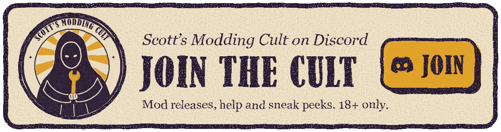

# Sin Spire Mod Loader

<a href="https://discord.gg/pjTY3jhbVz"></a>

A one-click patch and a small framework for modding Sin Spire, with a set of preset mods. Put each mod in one `Mods` folder, tick the ones you want, and play.

**You need your own copy of Sin Spire.** This repository does not include the game. Gooner DLC's pak (from the Get Mods tab) does include one mesh cut from the game's player model, as `CREDITS.txt` notes.

## Download

**[Download the patch](https://github.com/Scott-s-Modding-Cult/sin-spire-modloader/releases/latest/download/SinSpire-ModLoader-Patch.exe)** (`SinSpire-ModLoader-Patch.exe`). This link always gives the newest version, so it is the only one you need, and you only download it once: the loader then checks for new versions by itself (at most once a day, after the game has started) and asks at the next start whether to update. The Mod Manager's Get Mods tab shows it too. Older patch releases stay on the Releases page only for reference.

## Preset mods

The mods in `mods\` come with the patch and appear in the Mod Manager, where each can be turned on or off.

| Mod | What it does | Keys |
| --- | --- | --- |
| Admin Panel | Cheat panel, opened from a button in the pause menu | Esc |
| Crab Pair | Headcrab pair distraction. Silent without Plant Distractor, whose sounds it uses | F9 |
| Enemy Randomizer | Any regular enemy can appear at any dungeon spawn. Set it up in the admin panel or `mod-randomizer.json`, which is read at launch | |
| Ghost Kiss | LostSoul kiss | |
| Monitor Setting | Adds a Monitor row to the video settings | |
| Plant Distractor | Plant pair distraction placed in each level, with a volume slider | |

These mods are adult content. `sync_mods.ps1` refreshes `mods\` from a game's `Mods` folder. It leaves out personal settings.

`mods\` also holds a zip of each of these mods, to unpack straight into a game's `Mods` folder. `make_release_zips.ps1 -InMods` remakes them.

The [mod browser](https://scott-s-modding-cult.github.io/sin-spire-modloader/mods/) reads `docs\mods\mods.json`. `update_mod_browser.ps1` fills in each mod's version, size, keys and requirements there, and both scripts above run it. Each mod's icon, category, summary and details are written by hand in that file. The script warns about any mod that is new or whose zip has changed, until its text has been checked and its `stamp` copied to `checked`.

The Mod Manager's **Get Mods** tab installs and updates mods from those zips. An update replaces the mod's folder and keeps your settings, and the old version is saved in `Mods\.modloader\backup`. A mod that came with the patch shows as Installed until it is updated once, because its age is not known until then.

## Building the patch

You need Windows, which already includes the compiler this uses, and a copy of [UE4SS](https://github.com/UE4SS-RE/RE-UE4SS) that works with the game. The loader was tested with v3.0.1 Beta. UE4SS's `dwmapi.dll` and `ue4ss` folder get packed into the patch.

Double-click **`Build Patch.bat`**. It opens the `dist` folder when it finishes, with `SinSpire-ModLoader-Patch.exe` inside.

It looks for UE4SS in a `ue4ss_files` folder beside the script, then in any Steam copy of the game that has it. If it finds none, it asks you to choose the folder. It takes the patch's icon from your copy of the game when it can find one.

To choose the folders yourself, run the script directly:

```powershell
.\build.ps1 -GameDir "D:\SteamLibrary\steamapps\common\Sin Spire" -Ue4ssDir "C:\path\to\folder\with\dwmapi.dll"
```

## Patching the game

1. Close the game.
2. Run `SinSpire-ModLoader-Patch.exe`. It looks for the game by itself and selects a Steam copy first.
3. Check the folder it chose, then click **Patch Game**.

The patch asks Steam for its libraries and installed games, then checks a running copy of the game, Windows' list of installed programs, the folders around the patch, and common game folders on each drive. If none of those has the game, it searches the top few levels of your drives for up to 8 seconds. If that also fails, it asks you to choose the folder, and it accepts a choice just above or inside the game's folder.

The patch keeps the game's own exe as `SinSpire-Original.exe` and installs the loader as `SinSpire.exe`. Mods already installed in `ue4ss\Mods` or `Content\Paks\~mods` are moved into `Mods`, and each stays on or off as it was. It is safe to run again.

The patch always leaves the game with the UE4SS it carries (v3.0.1 Beta, 1ceefac8), the build the mods here are made and tested for; a mod with a C++ part only loads in that exact build. Any other UE4SS already installed, older or newer, is replaced, and the files it overwrites are saved in `Mods\.modloader\ue4ss_before_patch`. That UE4SS's settings stay, and the mods in its `ue4ss\Mods` folder move into `Mods` like any others. UE4SS 3.0.1 keeps its files straight in `Win64` rather than in a `ue4ss` folder; its Lua mods move into `Mods`, each staying on or off as it was.

**Remove Patch** puts the original exe back and takes away the links. If the patch installed UE4SS, it removes that too, and if it replaced another UE4SS, it puts that one back. The `Mods` folder is kept.

A Steam update or file verification restores the game's exe, which turns the loader off. Run the patch again afterwards.

**Updates.** Each patch records its release (`patch-YYYY.MM.DD`) in `Mods\.modloader\install.txt`. After the game starts, the loader asks GitHub for the newest full release whose tag starts with `patch-` (other releases, such as single mods, are passed over) and remembers it in `Mods\.modloader\update.txt`. At the next start it offers **Update**, **Skip This Version** or **Not Now**. Update downloads the patch, checks it against GitHub's size and SHA-256, and hands over to it: the patch waits for the loader to close, patches the game as usual and starts it again. Its log is `Mods\.modloader\update.log`. A release only reaches players when it is a full release (not a pre-release) tagged `patch-YYYY.MM.DD` with `SinSpire-ModLoader-Patch.exe` attached, and built with `build.ps1 -Tag` set to that same tag. Patches from before 2026-11-14 have no updater: run the new patch once.

To bring mods to another copy of the game, run the patch from a folder that has a `Mods` folder beside it and choose the other copy.

## Using mods

Put each mod in its own folder:

```
Sin Spire\
  Mods\
    MyMod\
      mod.json              Optional details, described below
      Scripts\main.lua      A UE4SS Lua mod
      Paks\                 .pak, .ucas, .utoc and .sig files for Content\Paks\~mods
      LogicMods\            Files for Content\Paks\LogicMods
      Shared\MyLibrary\     A Lua library other mods can require
```

A mod can have any of these parts, and a plain UE4SS mod works as it is.

Hold **Shift** while starting the game, or run `Mod Manager.bat`, to turn mods on and off and change their order. The window also lists problems such as two mods using the same key.

Every launch, the loader links the enabled mods into the places UE4SS and the engine look for them and writes UE4SS's load order. Mods that are off are removed from those places, but their files stay in `Mods`. The log is `Mods\.modloader\modloader.log`.

Load order applies to Lua mods. Pak files are all mounted, but the list does not set which pak wins when two change the same asset.

## mod.json

Every field is optional.

```json
{
    "title": "My Mod",
    "version": "1.0.0",
    "author": "You",
    "description": "What it does.",
    "requires": ["ModKit"],
    "load_after": ["OtherMod"],
    "keys": ["F2"],
    "enabled_by_default": true,
    "always_on": false,
    "preset": false
}
```

| Field | Meaning |
| --- | --- |
| `requires` | The mod does not load unless these do, and it loads after them. |
| `load_after` | Load after these if they are on, but do not need them. |
| `keys` | Only used to warn about clashes. |
| `always_on` | The Mod Manager will not let this be turned off. |
| `preset` | The Mod Manager says the mod comes with the loader. |

## ModKit

ModKit is a Lua library installed with the loader. Add `"requires": ["ModKit"]` to use it.

```lua
local ModKit = require("ModKit")
local mod = ModKit.new("MyMod")           -- The mod's folder name.

mod.log("Hello")                          -- Goes to UE4SS.log as [MyMod] Hello.
mod.on_key(Key.F2, function() end)        -- A Lua error is logged and the key keeps working.
mod.loop(100, function() end)             -- Game-thread loop that survives errors. Keep to one per mod.
mod.send("MyMod_Value", 5)                -- Mods have separate Lua states, so this is how they talk.
mod.get("MyMod_Value", 0)                 -- Reads it from any mod, with a fallback.
ModKit.is_loaded("OtherMod")              -- Whether the loader started that mod this launch.

local volume = mod.slider({ key = "Volume", label = "My Volume", tab = "audio", min = 0, max = 100, step = 5, default = 50 })
require("ModSettings").StartPolling()     -- Unless the mod already calls ModSettings.Poll() from its own tick.
```

The slider adds a saved row to the game's settings menu. Read `volume.value` to get its value. The game's controller navigation reaches the row like its own: it turns red, and left and right on the pad move the slider.

### Controller

UE4SS key binds only see the keyboard. The `Pad` module reads controller buttons from the game's own key state instead:

```lua
local Pad = require("Pad")

Pad.down(Pad.A)                                -- Whether a button is held right now.
local reader = Pad.Reader({ Pad.UP, Pad.A })   -- Remembers presses between updates.
reader:update()                                -- From a game-thread loop, every 20 to 30 ms for menus.
reader:pressed(Pad.A)                          -- Went down since the last update.
reader:repeated(Pad.UP)                        -- Pressed, or held long enough to repeat as menus do.
Pad.using_gamepad()                            -- Whether the game last saw a controller rather than mouse and keys.
Pad.action_keys("Interact", { Pad.X })         -- The controller buttons the game binds to one of its actions.
```

The game's own menus handle the controller themselves, so their buttons read as up here while one of them has focus. The game already uses every button in play, so a mod action is best put on an Admin Panel tab, which works with the controller, rather than on a button of its own.

## Testing

`tests\test_patch.ps1` runs the patch and launcher against a fake game folder in your temp directory, with no real game files involved. Build first. Holding Shift while it runs opens the Mod Manager, which the test closes before trying again.

## Donating

The loader and its preset mods are free. If you'd like to chip in, you can donate on the [donation page](https://scott-s-modding-cult.github.io/sin-spire-modloader/). Donations go to the loader's author, not to the developers of Sin Spire or the creators listed in the credits.

## Mod downloads

Some mods are also on the [Releases page](https://github.com/Scott-s-Modding-Cult/sin-spire-modloader/releases) as zips. Backrooms is too big to keep unzipped in this repository, so it does not come with the patch, but `mods\Backrooms.zip` holds the latest version, and the Mod Manager's Get Mods tab installs it. With the patch installed, unzip one into the game's `Mods` folder and it appears in the Mod Manager. `make_release_zips.ps1` makes the zips.

## Credits

Built on [UE4SS](https://github.com/UE4SS-RE/RE-UE4SS). Not affiliated with the developers of Sin Spire. See [CREDITS.txt](CREDITS.txt) for the creators of the sounds and models the preset mods use.
